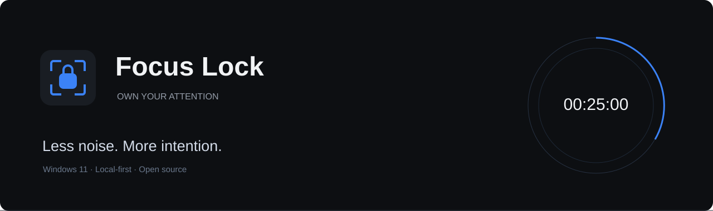
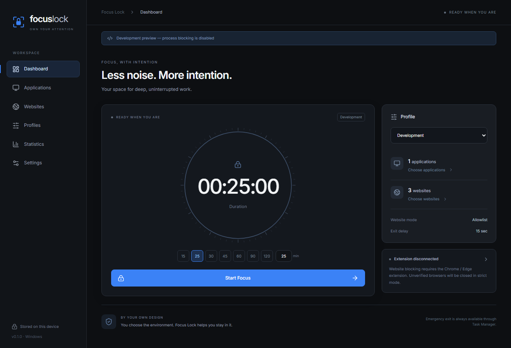
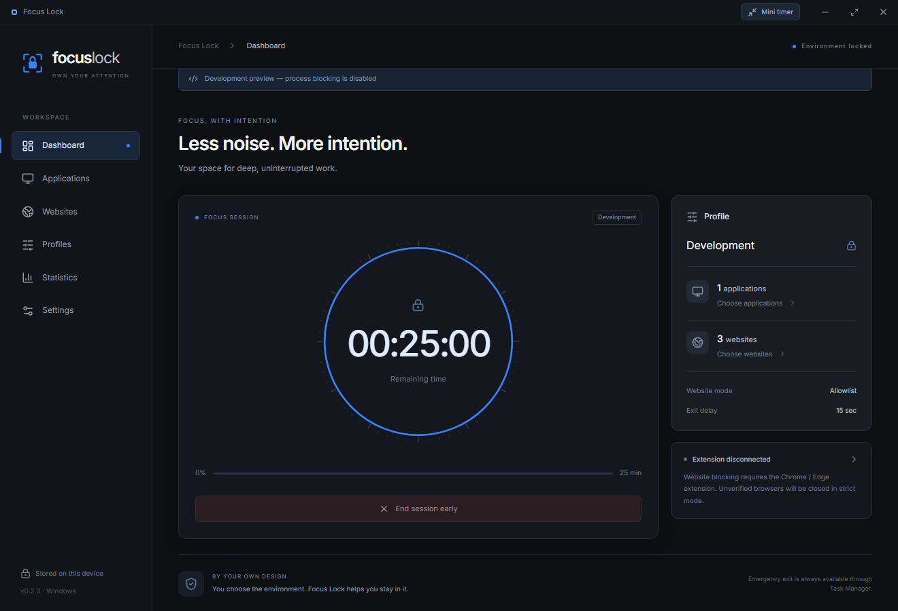
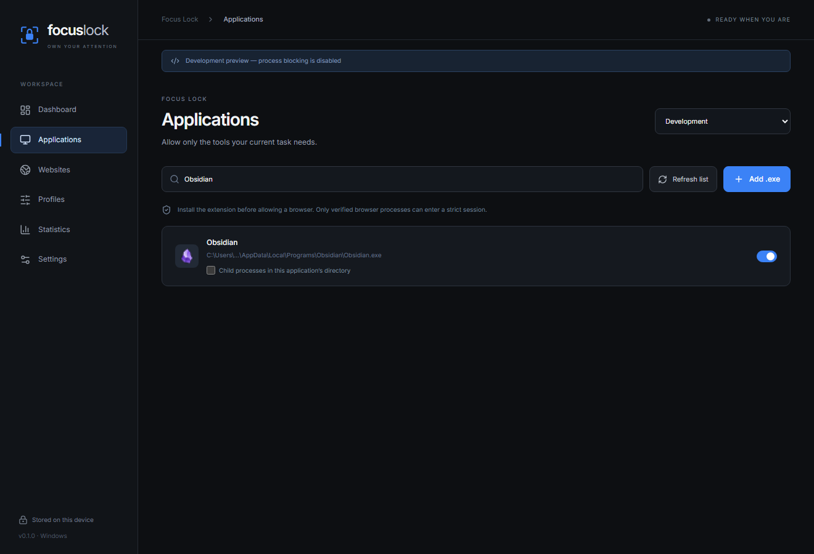
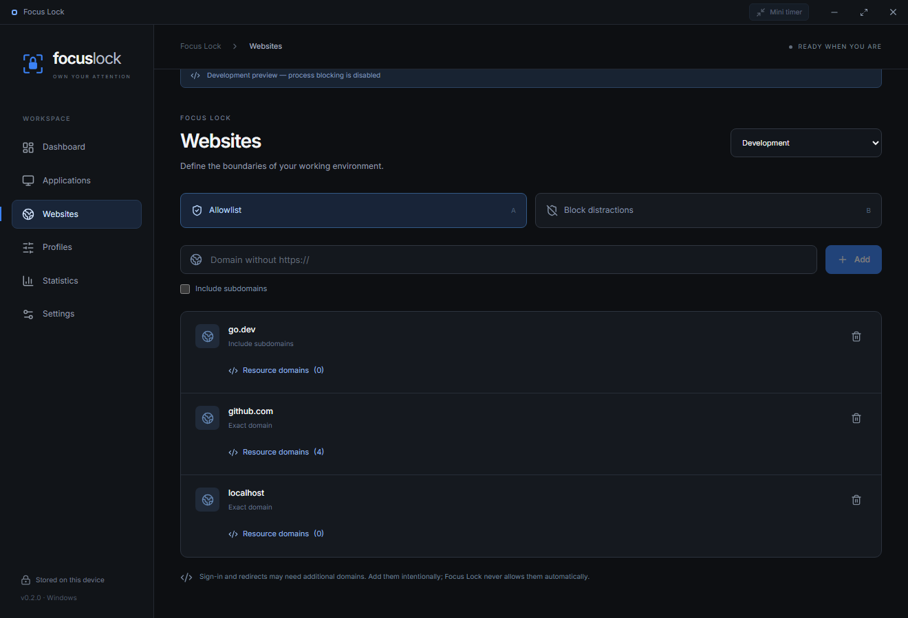
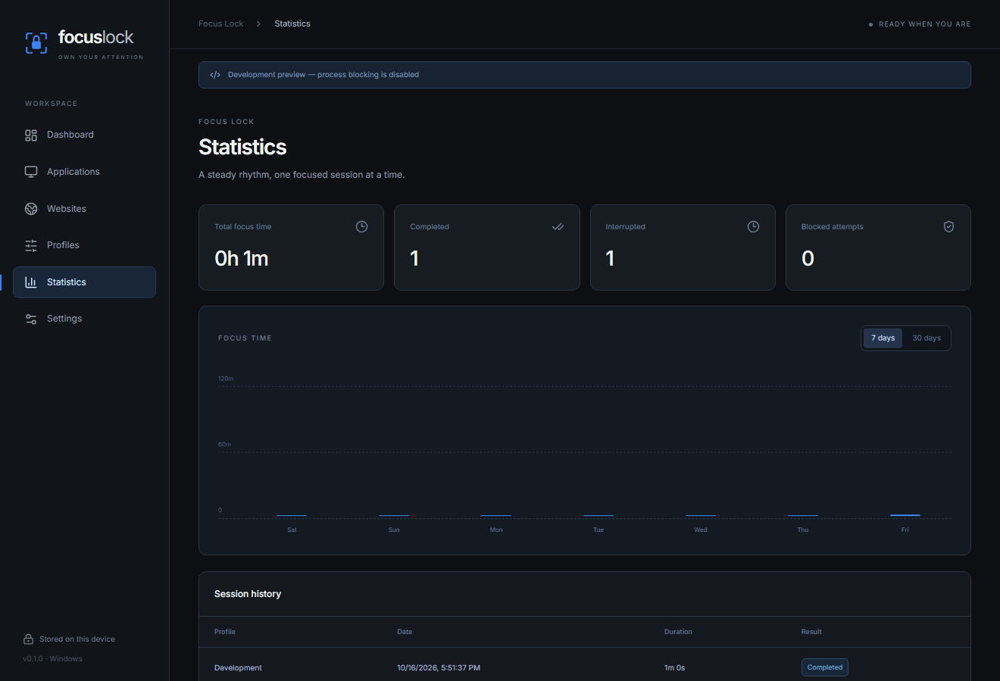
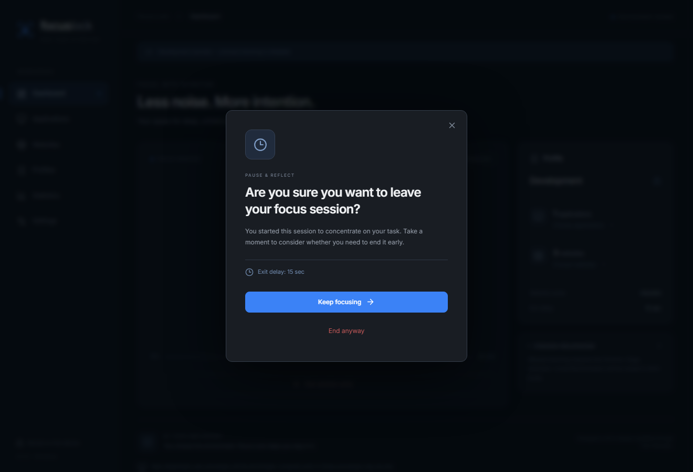

<p align="center"></p>
<h1 align="center">Focus Lock</h1>
<p align="center">Choose your tools. Set your time. Own your attention.</p>
<p align="center">
  <a href="https://github.com/Karench0/focus-lock/releases"></a>
  <a href="LICENSE"></a>
  
  <a href="https://github.com/Karench0/focus-lock/actions/workflows/ci.yml"></a>
</p>
<p align="center"><a href="https://github.com/Karench0/focus-lock/releases">Download the Windows preview</a> · <a href="docs/architecture.md">Architecture</a> · <a href="docs/testing.md">Test coverage & release gates</a></p>



## Overview

Focus Lock is a local desktop app for voluntary, time-limited focus on Windows 11. Pick the applications and websites your task needs, choose a session length, and let the app enforce those boundaries. The interface is deliberately quiet: graphite surfaces, clear typography, a single blue accent, and a timer that stays in charge of the screen.

**0.1.0 is a prerelease.** Process control and Chromium website filtering are implemented, but this is not an OS security boundary. Read the limitations below before using it with valuable unsaved work. Task Manager remains available as an emergency exit.

## Features

- Application discovery with native executable icons, search, a manual `.exe` picker, and full-path allowlists.
- Explicit child-process permission limited to the selected application's installation directory.
- Strict website allowlist by default, or a distraction blocklist; exact domains, optional subdomains, IDN normalization and localhost.
- Separate profiles for work, reading, study, and any task you create.
- A draggable, always-on-top mini timer with a short resize animation and the same exit procedure as the main window: confirmation/delay for ordinary sessions, or a Kotlin question for the personal exercise.
- Go-owned session and exit clocks, preset or custom lengths, configurable exit delay, and cancellation of an early exit.
- SQLite settings, local session history, daily/weekly charts and aggregate blocked-attempt counts.
- A Windows tray icon, close-window choices, completion notification, and English/Russian UI (Russian by default).
- Manifest V3 extension for Chrome and Edge with session-only rules, Native Messaging, a short lease, and fail-open recovery.
- Portable ZIP, optional per-user installer, Windows CI and tag-triggered GitHub Releases with SHA-256 checksums.

## Screenshots

Screenshots are captured from the implemented interface. Diagnostic-preview images carry a visible banner because process enforcement is disabled in that mode; session clocks, profiles and statistics still use the real Go backend and SQLite. They do not demonstrate tested OS-wide enforcement.

| Dashboard | Active session |
| --- | --- |
|  |  |
| Applications | Websites |
|  |  |
| Statistics | Early exit |
|  |  |

## Installation

1. Open [Releases](https://github.com/Karench0/focus-lock/releases) and download the Windows x64 ZIP or setup executable.
2. For the ZIP, extract **the whole archive** into a folder you will keep. Run `FocusLock.exe` next to `FocusLock-host.exe` and `browser-extension/`. For setup, run the per-user installer; administrator rights are not required.
3. Microsoft Edge WebView2 Runtime is required. Windows 11 normally includes it. The packaged Wails bootstrapper can install the runtime if missing; this may need an internet connection on first use. Local app operation needs no internet.
4. Complete onboarding. To filter websites, connect the extension as described below.

The binaries are **not digitally signed**. No signing certificate is included. Do not bypass organizational security controls to install the app; follow your organization's software policy.

### Connect Chrome or Edge

1. In Focus Lock → **Settings**, click **Connect local bridge**. This registers a current-user Native Messaging host for Chrome and Edge. It does not install the extension.
2. Open `chrome://extensions` or `edge://extensions` and enable Developer mode.
3. Choose **Load unpacked**, then select the included `browser-extension` folder.
4. Wait for the app to report **Extension connected** (reconnection can take up to 30 seconds), or reload the extension after opening Focus Lock.
5. Keep the extension enabled in the browser profile you use for focus. Browser roots without a verified extension connection are excluded from strict sessions. Incognito, guest mode, other profiles and browser variants are not certified; do not rely on them for filtering.

The unpacked extension has a stable public-key-derived ID, `ilmpmofmjbomibcnecekibjejgbpgcdb`. The key is public identity metadata, not a password or signing certificate. The extension is not published to a browser store in this release.

## Quick Start

1. Select a profile and open **Applications**. Allow your editor, reader, terminal or other required tools. Add portable executables with **Add .exe**.
2. In **Websites**, add domains such as `go.dev` and `github.com`. Enable subdomains only when needed. Add `localhost` explicitly for local development; any port is then allowed for that hostname. If styles, scripts or images are hosted elsewhere, expand **Resource domains** for the site and approve its exact CDN domains. GitHub offers an explicit suggestion button. These permissions allow resources only from that site, not navigation or embedded frames to the CDN.
3. During a session, click **Mini timer** in the title bar. Drag its grip to move it; use the arrow to return to the original window. Stop requests confirmation and keeps restrictions active throughout the configured delay. The minus icon hides it in the system tray; the tray’s Open item restores the full window.
4. Configure an early-exit delay in **Settings** (60 seconds by default).
5. Return to Dashboard, choose 15–120 minutes or a custom 1–1440 minutes, and press **Start Focus**.
6. If the preflight lists disallowed open applications, save your work and close them, or update the profile. Retry when ready. Starting an ordinary profile never silently kills these existing windows. The separate personal exercise requires explicit consent to close its reviewed list of applications.
7. Work until the timer ends. To leave early, confirm and wait out your chosen delay. You can cancel that countdown while the main timer continues.

Closing the window during a session offers **Minimize to tray** or the early-exit procedure. Use the tray icon to reopen it. If needed, end `FocusLock.exe` in Task Manager; process enforcement stops immediately, and the extension clears its rules on native disconnection or lease expiry.

## How It Works

The Go process owns the state machine `IDLE → ACTIVE → EXIT_PENDING → FINISHED`. Cancelling an exit returns to `ACTIVE`. Time comparisons use Go's in-process monotonic timestamps; React displays backend snapshots. The earliest deadline wins even if a scheduler tick observes both deadlines at once.

Every 700 ms, the app inspects same-user processes in the current Windows session. Newly observed disallowed user processes are terminated after identity and safety checks. System paths, protected/critical processes, elevated processes, other users and sessions, security agents and known accessibility tools are exempt. Ordinary sessions leave existing background processes alone. The personal exercise also reviews existing unrelated background processes for closure, then rechecks process identity against the confirmed list before starting. Process polling cannot prevent the first instructions of an executable from running.

The extension exchanges rules through a tiny Native Messaging executable and a current-user-ACL named pipe. The app checks the connecting host path and its Chrome/Edge parent process. Each rule update is acknowledged after `declarativeNetRequest.updateSessionRules` succeeds. In a strict session, a browser needs a recent acknowledgement for its browser process tree. The extension never edits `hosts`, proxy settings, firewall rules or system policies.

Only in-memory browser session rules are installed. The native connection keeps the service worker alive, messages renew a maximum six-second lease, disconnect clears rules, and an alarm acts as a fallback. Browser scheduling or suspension can delay JavaScript cleanup; no hard real-time guarantee is claimed. Restarting the browser drops session rules. A host registration is persistent integration metadata, not a persistent blocking rule.

## Technology Stack

| Layer | Technology |
| --- | --- |
| Desktop | Go 1.25+, Wails 2.16, Windows API, WebView2 |
| UI | React, TypeScript, Tailwind CSS, Lucide, Framer Motion, locally bundled Inter |
| Storage | SQLite via a pure-Go driver; WAL; schema in `internal/storage/schema.sql` |
| Browser | Chromium Manifest V3, DNR session rules, Native Messaging |
| Distribution | GitHub Actions, Inno Setup, portable ZIP, SHA-256 |

## Development

Prerequisites: Windows 11 x64, Go **1.25.6+**, Node.js **24 LTS**, Git, and WebView2. A C compiler such as MSYS2/MinGW is needed for `go test -race`; regular Windows builds use the pure-Go SQLite driver. Inno Setup 6 is optional for installers.

```powershell
git clone https://github.com/Karench0/focus-lock.git
cd focus-lock
go install github.com/wailsapp/wails/v2/cmd/wails@v2.16.0
cd ui
npm ci
npm run build
cd ..
wails dev
```

Build the complete distributable (includes the native host and extension):

```powershell
./scripts/build.ps1
./scripts/package.ps1 -Version 0.3.1
# Optional, with Inno Setup 6 installed:
./scripts/package.ps1 -Version 0.3.1 -Installer
```

The app is at `build/bin/FocusLock.exe`; release assets are under `build/release/`. `wails build` alone only builds the GUI, so use the script for a complete package. In development, register a host built beside the GUI if you test Native Messaging.

Checks:

```powershell
cd ui
npm run typecheck
npm run lint
npm test
npm run build
cd ..
go vet ./...
go test -race -count=1 ./...
```

For safe UI diagnostics, run `build/bin/FocusLock.exe --preview`. It serves an authenticated loopback preview and prints a random URL. A GUI build can write the URL to a file named by `FOCUS_LOCK_PREVIEW_URL_FILE`. **Process control is disabled and visibly labelled in preview.** Set `FOCUS_LOCK_DATA_DIR` to an isolated directory for tests. Production sessions do not expose an HTTP API.

## Project Structure

```text
main.go, preview.go          Wails lifecycle, command boundary, diagnostic preview
internal/
  session/                  Session state machine and monotonic deadlines
  applications/             Discovery, icons, process policy and Windows control
  websites/                 Domain normalization
  profiles/                 Profile validation
  statistics/               Local aggregation
  storage/                  SQLite repository and schema
  bridge/                   Named pipe, identity and native-message framing
  api/                      Validated service and enforcement loop
cmd/focus-lock-host/         Browser-launched stdio host
ui/                         React UI, styles, translations and dependency lockfile
browser-extension/          MV3 worker, DNR compiler, block page, tests
scripts/                    Build, package and per-user installer
docs/                       Architecture, test evidence and release notes
.github/                    Windows CI, release automation and issue templates
```

## Security & Limitations

- This is voluntary self-discipline software. An administrator, renamed executable, alternate browser, disabled extension, unverified profile, or deliberate manipulation can bypass it. Task Manager is never blocked.
- Polling is reactive. It can close a newly launched application, and **unsaved work in that process may be lost**. Save work before starting. Existing background processes are exempt in ordinary sessions; the personal exercise includes unrelated background processes in its explicit closure review. This preview does not provide exhaustive control of every installed application, UWP activation or every security/accessibility product.
- Known browsers are recognized by executable family and a verified native-host parent tree. Multiple profiles may share a browser root, and extension permissions/incognito settings are not fully attestable. Use one dedicated browser profile. Unsupported browsers are excluded when recognized, but detection is not a universal browser classifier.
- Allowed child processes must remain inside the allowed program's directory. Some programs need additional explicit executables. Allowing a terminal/editor/interpreter inherently enables more ways to launch other code.
- Web filtering covers HTTP(S) navigation and network requests (including WebSockets), not `file:`, internal browser pages, cached service-worker responses, browser-internal features, existing offline pages, VPN software or other apps' network traffic. Ordinary sessions leave previously loaded pages in place; starting the personal exercise replaces already-open disallowed HTTP(S) tabs with the blocked page.
- Login, CDNs, redirects and embedded content may need extra domains. Nothing is automatically allowlisted; review and add the dependencies you need before the session.
- Native host registrations are per-user HKCU entries. The installer removes them on uninstall. For a portable install, delete the two `...\NativeMessagingHosts\com.focuslock.bridge` keys under `HKCU\Software\Google\Chrome` and `HKCU\Software\Microsoft\Edge`, remove the extension, and delete the app folder. Data at `%LOCALAPPDATA%\FocusLock` can be removed separately.
- After a crash/reboot the app starts idle, marks an unfinished record as recovered and never restores enforcement. Focus time after the last persisted heartbeat is not credited. Sleep/suspend and browser scheduling still require testing across hardware before a stable release.
- There is no telemetry, cloud account or auto-update service. Profiles contain local executable paths; keep the local database private. Only counts of blocked attempts are saved, not visited URLs or page content.

See [SECURITY.md](SECURITY.md) and the [test matrix](docs/testing.md). Please report a fail-open failure or a system-process false positive promptly.

## Contributing

Read [CONTRIBUTING.md](CONTRIBUTING.md), open a focused issue, and include reproducible Windows/browser versions for bugs. Changes to process safety or crash recovery need regression tests and a clear threat-model explanation. We do not accept drivers, anti-Task-Manager measures or irreversible restrictions.

## License

[MIT](LICENSE), copyright © 2026 Karen Mkrtchyan. Third-party libraries retain their own licenses; see [THIRD_PARTY_NOTICES.md](THIRD_PARTY_NOTICES.md).

## Personal Kotlin exercise

In Settings, activate the small circle near the bottom-right three times within 1.6 seconds (each gap no more than 0.8 seconds). The cursor deliberately stays ordinary. The extra panel contains **Storozhenko mode**. This personal mode requires the explicit “I am Storozhenko” confirmation; the app does not infer or verify a person's identity from their account name.

Save work before confirming: the review lists unrelated apps that will close; already-open unrelated HTTP(S) tabs are replaced with the blocked page. Only the default Chrome/Edge with the updated connected extension and installed IntelliJ IDEA/Android Studio are allowed, plus existing system/security/accessibility exemptions. The study website is `kotlinlang.org`, with fonts from `resources.jetbrains.com` permitted only as site resources. YouTube/TikTok and Steam/Dota are outside this temporary policy, even if an ordinary profile allows them.

Elevated apps and processes without termination permission are skipped. If Windows or an antivirus denies closure after the review, that process is exempted for its current instance and the exercise continues closing ordinary disallowed apps. This does not request administrator privileges or count the skipped process as closed.

The default browser opens https://kotlinlang.org/docs/home.html. A correct answer to one of 20 middle-level Russian Kotlin questions (eight shuffled options) finishes the exercise. A wrong answer leaves it active and offers a different question. Normal profiles/settings remain intact. No hidden mode survives an app restart. Task Manager remains an emergency exit; this is a voluntary local focus tool.
